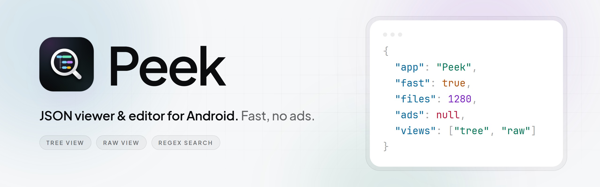
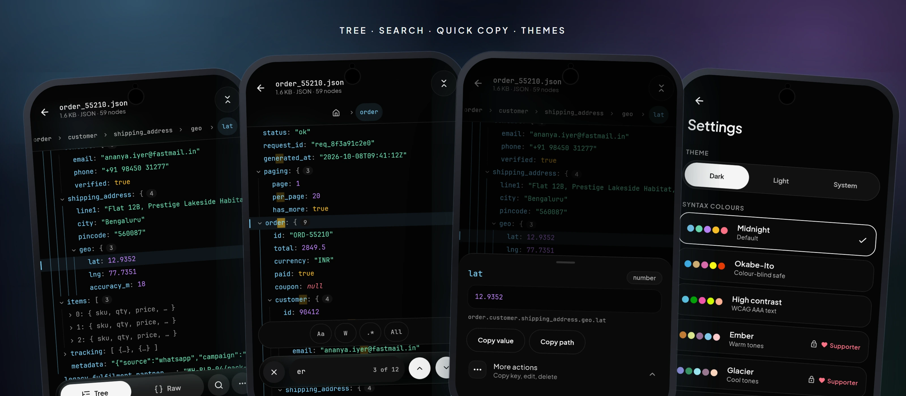
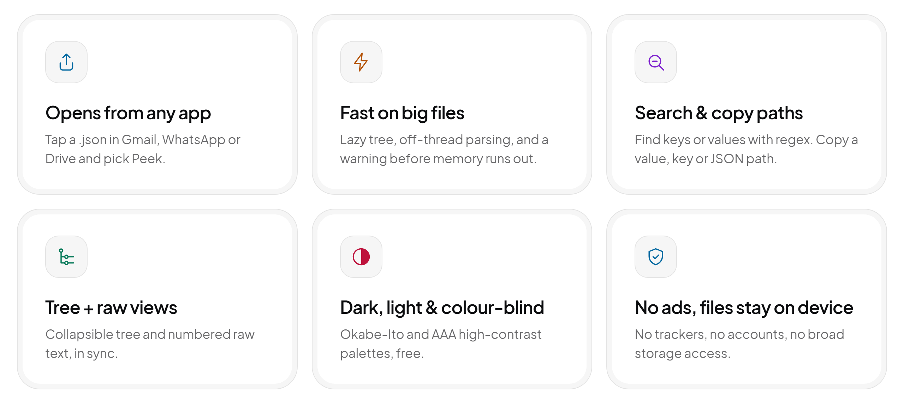

<picture>
  <source media="(prefers-color-scheme: dark)" srcset="assets/banner-dark.png">
  <source media="(prefers-color-scheme: light)" srcset="assets/banner-light.png">
  
</picture>

<h3>Open any JSON file on your phone and read it as a clean, collapsible tree.</h3>

A fast <b>JSON viewer and editor for Android</b>. Tap a <code>.json</code> file in Gmail, WhatsApp, Drive or your file manager, choose Peek, done. No ads, no account, and your files never leave your device.

  
  
  
  

  <a href="https://play.google.com/store/apps/details?id=com.zenexis.peek"><b>Google Play</b></a> &nbsp;·&nbsp;
  <a href="https://peek-json.zenexis.workers.dev/">Website</a> &nbsp;·&nbsp;
  <a href="https://peek-json.zenexis.workers.dev/privacy/">Privacy</a> &nbsp;·&nbsp;
  <a href="../../issues/new/choose">Support</a>

 

  

 

## Everything you need to read JSON on a phone

  <picture>
    <source media="(prefers-color-scheme: dark)" srcset="assets/features-dark.png">
    <source media="(prefers-color-scheme: light)" srcset="assets/features-light.png">
    
  </picture>

<table>
<tr>
<td width="50%" valign="top">

**Open JSON from anywhere** 
Gmail, WhatsApp, Telegram, Drive and file managers via Open with and Share. Or pick a file, paste text, or open a link.

</td>
<td width="50%" valign="top">

**Read it your way** 
Collapsible tree with a breadcrumb, or raw text with line numbers. Pretty-print and minify in one tap.

</td>
</tr>
<tr>
<td valign="top">

**Find and copy fast** 
Search keys and values with case, whole-word and regex. Copy any value, key or full JSON path, for example <code>order.customer.address.city</code>.

</td>
<td valign="top">

**Edit when you need to** *(optional one-time unlock)* 
Change values, rename keys, delete nodes, raw edit, undo and redo, then save.

</td>
</tr>
</table>

**Supported formats:** `.json`, `.jsonl` / NDJSON, JSON with comments, trailing commas, BOM and JavaScript-style objects.

 

## Why Peek

|  | Typical JSON apps on Android | **Peek** |
|---|---|---|
| Ads | Often banner or full-screen | **None** |
| Opening a file | Move it to Downloads, grant storage access | **Tap it in the app you are already in** |
| Large files | Freeze or crash | **Warns first, offers a read-only text view** |
| Reading | Plain text, or a flat list | **Collapsible tree plus raw view, synced** |
| Colour-blind and high-contrast | Rarely | **Okabe-Ito and AAA palettes, free** |
| Your data | Sometimes uploaded or tracked | **Stays on your device** |

*Peek is a viewer and editor. It is not a JSON API client, a jq/JSONPath query tool, or a diff tool, and it does not convert to XML or CSV. It is built for phone-sized files, not multi-gigabyte data dumps. Android 7.0+ only.*

 

## Pricing

Viewing is **free, with no ads**. Two optional one-time purchases, no subscription: **Edit** (change values, rename keys, delete nodes, raw edit, undo/redo, save) and **Supporter** (extra colour palettes). Prices are set per country by Google Play.

 

## Privacy

<table>
<tr><td>

**Your files stay on your device.** File contents, names and paths are never uploaded. No ads, no trackers, no accounts. Optional anonymous error reports (no file contents, no device ID, IP addresses not stored) can be switched off in Settings.

Full policy: **https://peek-json.zenexis.workers.dev/privacy/**

</td></tr>
</table>

 

## FAQ

<b>How do I open a JSON file on Android?</b>

 
Tap the file in Gmail, WhatsApp, Telegram, Drive or your file manager and choose <b>Peek</b> from the Open with list. You can also open Peek and pick a file, paste JSON, or open a link.

<b>Do I need to move the file to Downloads first?</b>

 
No. Peek reads the file you tap and does not ask for broad storage access.

<b>Can I edit JSON on my phone?</b>

 
Yes, with the one-time <b>Edit</b> unlock: change values, rename keys, delete nodes, edit raw text, undo and redo, then save.

<b>Can it open large JSON files?</b>

 
Phone-sized files open as a tree. Bigger files get a warning before they could run out of memory, and Peek offers a read-only text view instead.

<b>Is there a colour-blind-friendly theme?</b>

 
Yes. Dark, light or system theme, plus Okabe-Ito (colour-blind safe) and a WCAG AAA high-contrast palette, all free. Extra palettes are part of the optional Supporter purchase.

<b>Does it show ads or collect my data?</b>

 
No ads, no trackers, no accounts. Your files are never uploaded. See the <a href="https://peek-json.zenexis.workers.dev/privacy/">privacy policy</a>.

<b>Is there an iPhone version?</b>

 
Not at the moment. Peek is Android 7.0 and up only.

More answers on the <a href="https://peek-json.zenexis.workers.dev/#faq">website</a>.

 

## Support and feedback

- **Bugs and ideas:** [open an issue](../../issues/new/choose). I reply within a few days.
- **Email:** [callmezenexis@gmail.com](mailto:callmezenexis@gmail.com)
- **In the app:** Settings, then Send feedback or Report a problem.

Please do not post private data from your files in public issues.

> This repository is the public product page and support desk for Peek. It does not contain the app's source code.

 

Made by <b>Zenexis</b> &nbsp;·&nbsp; <a href="https://peek-json.zenexis.workers.dev/">Website</a> &nbsp;·&nbsp; <a href="https://peek-json.zenexis.workers.dev/privacy/">Privacy</a> &nbsp;·&nbsp; <a href="mailto:callmezenexis@gmail.com">Contact</a> 
<i>Google Play and the Google Play logo are trademarks of Google LLC. Peek is not affiliated with or endorsed by Google.</i>

<i>json viewer android · json editor · open json file on phone · jsonl viewer · ndjson · json formatter · json pretty print · json path copy</i>

